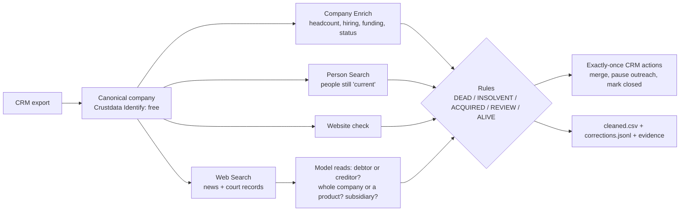

# Pulse: find the dead companies your data still says are alive

> **Timing note for the judges:** we understood the start had moved to 10:15 PM and began building then, so the first commit (10:37 PM) predates 11:00 PM. Everything after it was built from 11:00 PM. *(Update this line with what the organisers told you.)*

**One line:** Give Pulse a CRM export. For every account it decides **ALIVE, DEAD, INSOLVENT, ACQUIRED / RENAMED, or needs a person**, cites court records, press, website and hiring evidence with dates, and fixes the CRM: it merges duplicates, pauses outreach to dead companies exactly once, and writes a correction feed the data provider can ingest.

**Theme:** Infrastructure for agents (*"a tamper-proof record of where every fact came from"*, *"building blocks that still hold after … a lie"*) applied to Revenue (*"reach the right person … both change every week"*).

## What we found on real data

On an 18-account sample CRM of well-known Indian companies, using live Crustdata data:

| Company | Crustdata today | What Pulse found (cited) |
|---|---|---|
| **Builder.ai** | `status: active`, 1,419 employees, **473 people list it as current** | Bankrupt since **May 2025**: 3 press sources, website unreachable, no open jobs |
| **BluSmart** | `active`, 1,093 employees, **744 current** | Shut down **April 2025**: insolvency admitted by the NCLT (insolvency court), website 404, no hiring |
| **Koo** | `active`, 386 employees, **499 current** | Shut down **July 2024** |
| **Zilingo** | `active`, 133 employees, **119 current** | Collapsed **January 2023** |
| BYJU'S | `active` | **Insolvency** proceedings since July 2024, but still operating, so *not* a zombie |
| Unacademy | `active` | **Acquired by upGrad** (March 2026), confirmed by two separate reports, *overriding* January's "failed talks" |
| Razorpay | `active` | **Alive.** A subsidiary's *solvent voluntary liquidation* was noted and correctly not treated as failure |

**Result:** 4 dead companies are listed as active, and **1,835 people still list them as their current job**. Pulse merged 1 duplicate (Byjus = BYJU'S), paused 20 outreach contacts, and produced 6 data corrections. It matched **15 of 16** hand-labelled accounts; the one miss went to *human review*, not to a wrong verdict.

## The service, and who pays for it

- **Today:** RevOps teams, CRM-hygiene agencies and data-steward teams at data vendors pay people to find dead accounts, merge duplicates and track ownership changes. Sales teams email companies that no longer exist; recruiters and lenders act on stale records.
- **Why it's hard:** people don't update their profiles when their company dies. Headcount from profiles **lags the truth by months** (Builder.ai's recorded headcount kept *rising* after its insolvency). The evidence that a company is dead lives in court filings and the press, not in profile data.
- **Why it helps a data provider like Crustdata:** the correction feed (`corrections.jsonl`) is a ready-made, evidence-backed patch, e.g. `Builder.ai: basic_info.status active → closed, since May 2025, 473 people still current, sources: […]`.

## How it decides (rules decide, the model only reads)

For each account:
1. **One canonical company.** Free Company Identify gathers every matching record and keeps the canonical one, so "Byjus", "BYJU'S" and "BYJU'S (Think & Learn)" become one record. Duplicate CRM rows are merged into it.
2. **Evidence**, each item cited with its source and retrieval time:
   - Crustdata Company Enrich: headcount history, open jobs, last funding round, status
   - Crustdata Person Search: how many people still list the company as current
   - Crustdata Web Search: news and court records
   - the company's own website: up, down, parked, or redirecting to an acquirer
3. **A model reads the search results** (Gemini, or Claude) and answers narrow questions. Is this company the **debtor or the creditor** in a court case? Did the **whole company** shut down, or one product? Is it a **subsidiary** or a **solvent** liquidation? It must quote its source.
4. **Rules decide:**
   - **DEAD:** a shutdown reported by 2+ sources **and** corroboration from the data (website down, hiring stopped, headcount collapse).
   - **Signs of life veto DEAD.** Open jobs plus a working website means *conflicting evidence*, so it goes to a person.
   - **ACQUIRED:** 2+ sources, or the website redirecting to the acquirer. A single source goes to a person.
   - **INSOLVENT:** insolvency proceedings, kept separate from dead (BYJU'S still operates).
5. **Acts, exactly once:** merge duplicates, pause outreach sequences, mark accounts closed or update their identity. Every action is written to a ledger first, so re-running a job repeats nothing (tested: 12 of 12 skipped on re-run).
6. **Outputs:** `cleaned.csv` (the CRM with status, date, reason and sources), `corrections.jsonl` (for the data provider), `report.json` (all evidence).

**The same case gets the same answer:** every model reading is cached on its exact input. Before we added that, one company flipped between two runs.

## The hardest cases

1. **Razorpay looked dead.** A court record named it, and a liquidation result appeared. In fact, payment companies *file* insolvency cases against merchants (creditor, not debtor), and the liquidation concerned a *subsidiary* in a *solvent* voluntary liquidation. Fixes: debtor-vs-creditor and subsidiary questions in the reading, official court sites only for "legal record", and the signs-of-life veto.
2. **Profile headcount lies by omission.** Builder.ai's employee count kept growing after it went bankrupt, so headcount can never prove a company is alive. Proof of death comes from courts and the press, corroborated by the website and by hiring stopping.
3. **News conflicts over time.** In January 2026, "failed acquisition talks with upGrad"; in March 2026, "Unacademy sells to upGrad for $206M". Pulse takes the later, two-source fact and cites the date.
4. **One company, many records.** "Byjus" resolves to a stub record in the graph. We keep the richest record and merge the CRM rows into it.

## Approaches we tried, and what didn't work

- **Resume background verification (first build, still in the repo at `/resume`):** worked, but it was crowded with other teams' ideas, and student resumes are mostly unverifiable because profiles lag.
- **Fraud rings across a pile of job applications (`/batch`):** worked on a test pile (rings 8/8 held, 0/10 honest held, a BYJU'S layoff cohort *explained* by a 19% headcount drop). Building it taught us that **company records are stale for dead companies**, and that's how Pulse started.
- **Early warning from headcount alone:** failed. Builder.ai's and BluSmart's headcount was still rising until after they collapsed. Only Dunzo showed an early decline.
- **Fuzzy company-name matching:** matched "NoBroker" to "NEOBROKER" and "Chill Hai" to "CHILL". We switched to strict matching, because a wrong match is worse than "can't tell".

## What we left out, and what's next

- **Crustdata watchers**, to re-check every account when a company's record changes, plus a nightly re-run of the whole CRM.
- **Ministry of Corporate Affairs (MCA) company-status lookups** (struck off / under liquidation) as a second official source.
- **Contacts at dead companies:** "473 people still list Builder.ai as current" could be followed by person enrich, to find where each contact actually moved.
- **Pushing corrections** into a CRM over its API (writes to Salesforce or HubSpot need the customer's OAuth, so tonight we write files).

## How it's built



- **State:** `data/pulse/<job>/` (report, cleaned CRM, correction feed), `data/pulse/crm_ledger.json` (actions), `data/cache/` (every Crustdata response and model reading, so a run can be replayed offline).
- **Runs on:** one FastAPI process (`app.py`). Pages: `/` (Pulse), `/batch` and `/resume` (earlier builds).

## Run it

```bash
python -m venv .venv && .venv/Scripts/pip install -r requirements.txt
cp .env.example .env     # GEMINI_API_KEY (or ANTHROPIC_API_KEY), CRUSTDATA_API_KEY, PRAMAAN_MODE=live
.venv/Scripts/python -m uvicorn app:app --port 8000 --reload      # http://localhost:8000 → "Use sample CRM"
```

The sample CRM is `redteam/crm_sample.csv`, and the hand labels are `redteam/crm_truth.json` (only labels we are confident of; Unacademy was scored only after we read its two sources).
