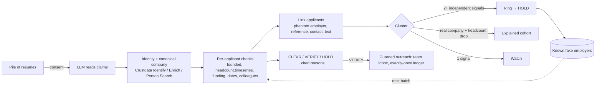

# Pramaan: catch the fraud rings that one-at-a-time background checks can't see

> **Timing note for the judges:** we understood the start had moved to 10:15 PM and began building then, so the first commit (10:37 PM) predates 11:00 PM. Everything after it was built from 11:00 PM. *(Update this line with what the organisers told you.)*

**One line:** Give Pramaan a pile of job applications. It checks every claim against data the candidate can't edit, finds the fake employers and coordinated resume rings that one-by-one checks miss, clears the honest applicants, and decides CLEAR / VERIFY / HOLD for each one, with a cited reason.

**Theme:** Hiring ("Prove or disprove every claim on a candidate's record", "Staff a thousand shifts from applications seeded with fakes"), with Trust and compliance ("Separate a fraud ring from companies that simply share an office").

## The service, and who pays for it

- **Today:** background-verification firms (AuthBridge, First Advantage, HireRight) and in-house HR teams. Employers pay per check, for each hire, and a check takes **7–14 days**.
- **The gap:** checks run **one candidate at a time**. Fake experience letters are sold by paper companies, so several applicants cite the *same* fake employer, the *same* "reference", the same copied bullets. Each resume looks fine alone; the pattern only shows across the pile. High-volume hiring (operations, sales, support) is where this happens most.
- **Why now:** Gartner expects 1 in 4 candidate profiles worldwide to be fake by 2028 ([source](https://www.personneltoday.com/hr/by-2028-one-in-four-candidate-profiles-will-be-fake)).

## What it does now, end to end

1. **Consent gate.** Nothing runs without recorded candidate consent.
2. **Reads every resume** (Gemini by default, or Claude; the model only *reads*): PDF, scan or two-column layout, turned into dated claims.
3. **Resolves identity and companies** in Crustdata:
   - A profile is attached only when employers **and** dates match. A shared employer alone is not identity.
   - "BYJU'S", "Byjus" and "BYJU'S (Think & Learn Pvt Ltd)" resolve to **one canonical company record**.
4. **Checks each applicant** with deterministic rules, against evidence labelled by **who controls it** (company records, third parties, the candidate's own profile):
   - Was the company founded before the job started?
   - Was the claimed team smaller than the whole company at the time, using `headcount.timeseries`?
   - Was the company at the claimed funding stage when they joined?
   - Do dates and title match? Do colleagues' profiles overlap? Do references check out?
5. **Links applicants to each other:**
   - phantom employer
   - same reference
   - same phone or email under different names
   - same profile URL
   - near-identical achievement text
   - (support only) same PDF tool
6. **Classifies each cluster:**
   - **Fraud ring:** at least **two independent** signals. One shared signal is only a *watch*.
   - **Explained cohort:** applicants who left the same *real* company together, **and** Crustdata's headcount history shows a drop that month. *"BYJU'S headcount fell 19% (34,613 → 27,969) around Aug 2023, when these applicants left."*
7. **Decides and acts:**
   - **HOLD:** ring member, or a known fake employer. A person makes the final call; there's no automatic reject.
   - **VERIFY:** employer confirmation, through guarded outreach.
   - **CLEAR:** every checked claim holds up.
8. **Remembers.** Phantom employers from one batch are known the next morning, so a new applicant citing one is held in under a second.

**Where a person is still needed:** HOLD decisions, identity ties between two real people, and documents a candidate uploads to explain a discrepancy.

## How we tested it

`redteam/batch_gen.py` builds a pile with known answers. All applicant names are invented; companies are real where stated, with live Crustdata data.

| In the pile | Count | Expected |
|---|---|---|
| Ring A: phantom employer, same reference, copied bullets | 5 | HOLD |
| Ring B: phantom employer, one phone number under three names, copied bullets | 3 | HOLD |
| Honest cohort that left BYJU'S in mid-2023 (real layoff) | 4 | not held, explained |
| Liars at real companies (funding stage, founded after join, team size) | 3 | flagged |
| Honest applicants at real companies, two from the same tiny local firm | 5 | not held |
| The same person resubmitted with reworded dates and company name | 1 | same decision |

**Result (`python -m redteam.batch_score`, Gemini reading all 21 PDFs, live Crustdata):**
**ring members held 8/8 · honest applicants held 0/10 · layoff cohort explained 4/4 · liars flagged 3/3 · duplicate consistent 1/1 · 95 s.**

*Honest limit:* we built both the pile and the rules, so this shows the system behaves as designed. It is not a measured field accuracy.

**Robustness tests:**
- `tests/test_batch_resume.py`: a batch that crashes on applicant 4 resumes without re-checking anyone.
- `tests/test_exactly_once.py`: a retried run never sends an email twice, and a send interrupted by a crash is never resent blindly.
- Crustdata 429s back off using `x-ratelimit-reset`. A 402 or 403 becomes a readable message. A busy model falls back to the next model in the chain.

## The hardest cases, and how it handles them

1. **Layoff cohort vs. fraud ring.** Both look identical at first: several applicants, same employer, same dates. We separate them with **independent evidence**:
   - The real company's headcount history shows the drop in the month the cohort left, so the group is explained.
   - The ring's employer has no company record, *and* its members share a reference or contact details, *and* copied text.
2. **Common names.** An invented "Rahul Verma" at Infosys was first matched to a *real* Rahul Verma at Infosys, and accused of wrong dates. Now a profile is attached only when employers **and** dates agree. Otherwise the candidate is "not found", and we never judge someone by a stranger's record.
3. **One company, many records.** Crustdata has stub records for big brands, so "Byjus" first resolved to an empty stub, and the cohort looked unexplained. We now collect every matching record and keep the canonical one (largest, with a website).

## What didn't work

- **Fuzzy company matching** matched "NoBroker" to "NEOBROKER" and "Chill Hai" to "CHILL", and marked both *Verified*. A wrong "Verified" is the worst error this product can make, so matching is now strict. A miss goes to the employer instead.
- **Agreement with the candidate's own profile.** The candidate writes both the resume and the profile, so agreement proves nothing. It's labelled "matches profile", never "verified".
- **Physics-based graph layout** tangled on stage-sized piles. We replaced it with a deterministic layout that groups clusters.
- **Model availability:** the newest Gemini models returned 503 and 504 errors at night. Pramaan now caps each call at 45 s and moves to the next model.

## Approaches we considered

1. **An LLM agent that decides everything.** Fast to build, but its verdicts change with the wording and its citations are hard to trust. We use it only for reading.
2. **Per-resume checks only.** That's what BGV firms already do, and it can't see coordinated fraud.
3. **What we chose:** deterministic per-claim checks, plus analysis **across** applicants, plus a company-history explanation for innocent clusters. Repeatable, cited and testable.

## What we left out, and what's next

- **Real employer contact addresses and inbound email.** Under the event rules, agents may contact only our team, so every message goes to a team inbox and replies are pasted in.
- **Watchers** for profile edits made *during* a check, and continuous re-verification for regulated roles.
- **Sharing known fake employers between firms** without exposing any candidate, as a hashed registry.

## How it's built



- **State:** `data/batches/` (batches), `data/runs/` (per-applicant reports and checkpoints), `data/known_fake_employers.json`, `data/outbox/ledger.json`, `data/cache/` (every Crustdata response, so a run can be replayed offline).
- **Runs on:** one FastAPI process (`app.py`) with a live event stream. Pages: `/batch` (the pile) and `/` (one applicant's full report).

## Run it

```bash
python -m venv .venv && .venv/Scripts/pip install -r requirements.txt
cp .env.example .env    # LLM_PROVIDER=gemini + GEMINI_API_KEY (or anthropic), CRUSTDATA_API_KEY, PRAMAAN_MODE=live, DEMO_INBOX
.venv/Scripts/python -m uvicorn app:app --port 8000          # http://localhost:8000/batch
python -m redteam.batch_gen && python -m redteam.batch_score  # the test pile and its scoreboard
python -m tests.batch_fixture && python -m tests.test_batch_resume && python -m tests.test_exactly_once
```

Modes: `live` calls Crustdata and caches every response; `replay` reads the cache only, for the stage if WiFi fails; `fixture` uses synthetic offline data (`fixtures/dataset.json`, all fictional).
