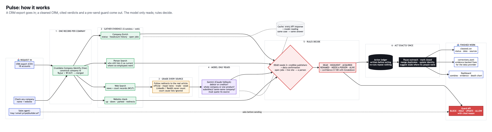

# Pulse: your CRM says they're alive. They're not.

> **Timing note for the judges:** we understood the start had moved to 10:15 PM and began building then, so the first commit (10:37 PM) predates 11:00 PM. Everything after it was built from 11:00 PM. *(Update this line with what the organisers told you.)*

> **Your data is lying to you.** Builder.ai went bankrupt in May 2025. Today the data graph still says it is *active*,
> with 1,419 employees, and 473 people still list it as their current job. Your CRM still has 6 contacts in an outreach sequence there.

**One line:** Pulse finds the dead companies your CRM and data provider still call active, cites the evidence for every verdict, and cleans up the CRM for you, every action exactly once.

**Theme:** Revenue + Infrastructure for agents (*"a check that stops a wrong email before it is sent"*, *"a tamper-proof record of where every fact came from"*).

| 🧟 Zombies found | 👥 People still "working" there | ✅ Hand labels matched | 🚫 False alarms | ⚙️ Done for you |
|:-:|:-:|:-:|:-:|:-:|
| **3** of 17 companies | **1,716** | **15 / 16** | **0** | 18 contacts paused · 1 duplicate merged · 5 data corrections |



## What we found on real data

On an 18-account sample CRM of well-known Indian companies, live Crustdata data, final run `P2dbef5f2`:

| Company | Crustdata today | What Pulse found (cited) |
|---|---|---|
| **Builder.ai** | `active`, 1,419 employees, **473 still current** | **Dead since May 2025** (88/100): Investing.com, TechMonitor, Bloomberg Government; website down, hiring stopped. Its recorded headcount *rose* 1,304 → 1,419 after it died |
| **BluSmart** | `active`, 1,093 employees, **744 still current** | **Dead since April 2025** (99/100): Indian Express, Down To Earth + an official NCLT record; website down |
| **Koo** | `active`, 386 employees, **499 still current** | **Dead since July 2024** (99/100): Livemint, India Today, First India. Headcount on record went **297 → 386 (+30%) after it shut down** |
| BYJU'S | `active` | **Insolvent** since July 2024 (NCLT, Bloomberg, NDTV) but still operating, so *not* a zombie |
| Unacademy | `active` | **Acquired by upGrad** (Yahoo Finance, Outlook Business, Entrackr) |
| Ezetap | no current record | **Renamed** to Razorpay POS (Economic Times, Times of India) |
| Zomato | `active` | **Alive.** It appeared on an insolvency court's daily *cause list*, which names hundreds of companies; Pulse knows that is not insolvency |
| Zilingo | `active` | **Distressed**, not Dead: only one credible outlet this run, and Pulse never calls a company dead on one source |

**Result:** 3 dead companies are listed as active, and **1,716 people still list them as their current job**. Pulse merged 1 duplicate
(Byjus = BYJU'S), paused 18 outreach contacts, suggested new leads at the companies their people moved to, and produced 5 evidence-backed
data corrections. It matched **15 of 16** hand-labelled accounts with **no false alarms**; the one miss (Zilingo) is a cautious
"Distressed", not a wrong verdict.

## The service, and who pays for it

- **Today:** RevOps teams, CRM-hygiene agencies and data-steward teams at data vendors pay people to find dead accounts, merge duplicates and track ownership changes. Sales teams email companies that no longer exist; recruiters and lenders act on stale records.
- **Why it's hard:** people don't update their profiles when their company dies. Headcount from profiles **lags the truth by months** (Builder.ai's recorded headcount kept *rising* after its insolvency). The evidence that a company is dead lives in court filings and the press, not in profile data.
- **Why it helps a data provider like Crustdata:** the correction feed (`corrections.jsonl`) is a ready-made, evidence-backed patch, e.g. `Builder.ai: basic_info.status active → closed, since May 2025, 473 people still current, sources: […]`.

## How it decides (rules decide, the model only reads)

For each account:
1. **One canonical company.** Free Company Identify gathers every matching record and keeps the canonical one, so "Byjus", "BYJU'S" and "BYJU'S (Think & Learn)" become one record. Duplicate CRM rows are merged into it.
2. **Evidence**, each item cited with its source and retrieval time:
   - Crustdata Company Enrich: headcount history, open jobs, last funding round, status
   - Crustdata Person Search: how many people still list the company as current
   - Crustdata Web Search: news and court records
   - the company's own website: up, down, parked, or redirecting to an acquirer
3. **A model reads the search results** (Gemini, or Claude) and answers narrow questions. Is this company the **debtor or the creditor** in a court case? Did the **whole company** shut down, or one product? Is it a **subsidiary** or a **solvent** liquidation? It must quote its source.
4. **Rules decide:**
   - **DEAD:** a shutdown reported by 2+ sources **and** corroboration from the data (website down, hiring stopped, headcount collapse).
   - **Signs of life veto DEAD.** Open jobs plus a working website means *conflicting evidence*, so it goes to a person.
   - **ACQUIRED:** 2+ sources, or the website redirecting to the acquirer. A single source goes to a person.
   - **INSOLVENT:** insolvency proceedings, kept separate from dead (BYJU'S still operates).
5. **Acts, exactly once:** merge duplicates, pause outreach sequences, mark accounts closed or update their identity. Every action is written to a ledger first, so re-running a job repeats nothing (tested: 12 of 12 skipped on re-run).
6. **Outputs:** `cleaned.csv` (the CRM with status, date, reason and sources), `corrections.jsonl` (for the data provider), `report.json` (all evidence).

**The same case gets the same answer:** every model reading is cached on its exact input. Before we added that, one company flipped between two runs.

## How sources are cited and weighed

Every verdict names the sources that decided it, with publisher, article date, the real article link (search redirects are
resolved) and the source's own words, plus a confidence level (high, medium, low).

| Source tier | Examples | Counts toward a verdict? |
|---|---|---|
| Official court / registry | nclt.gov.in, ibbi.gov.in, mca.gov.in, Companies House | Yes. But a filing alone at a company that is clearly operating goes to a person (NCLT also hears mergers and name changes) |
| Major news | Reuters, TechCrunch, Economic Times, Times of India, Mint, Inc42 | Yes |
| Other publications | trade, regional and niche press | Yes, but needs a major outlet alongside, or 3+ of them |
| Weak | LinkedIn, Reddit, Medium, wikis, company directories | Never: shown, not counted |

- **Dead:** a shutdown reported by 2+ distinct publishers (including an official or major outlet), plus a confirming sign in the data (website down, hiring stopped, headcount collapse). The same outlet three times counts once.
- **Insolvency court search:** whenever results hint at failure, Pulse also searches nclt.gov.in so an official record can be cited.
- **Namesakes rejected:** the reader is told the company's website, main country and description. Results about another company with the same name are ignored.

## Confidence score (0–100) and the death-vs-data chart

Every verdict carries a number, and the page shows how it adds up:

| Points | For |
|---|---|
| +20 | the verdict passed its rule (e.g. Dead: 2+ distinct publishers and a data check) |
| +35 / +25 / +12 / 0 | each distinct publisher that decided it: official court or registry / major news / other publication / weak |
| +10 each | data confirmation: website down, hiring stopped, headcount collapse, employee exodus |
| −15, −10 | for Dead only: the company still has open jobs, or its website is still up |

Sources are capped at 70; the total is kept between 5 and 99. 80+ = high, 55–79 = medium, below 55 = low. Alive scores
start at 50 (no credible failure report) plus open jobs (+20), website up (+15) and steady headcount (+10), minus 8 for each
unconfirmed credible failure mention. Sample results: Builder.ai Dead 88, BluSmart and Koo Dead 99, BYJU'S Insolvent 99,
Unacademy Acquired 92, Ezetap Renamed 80, Zilingo Distressed 35 (thin evidence, so low by design).

For every dead company, a small chart shows Crustdata's monthly headcount with the date it died marked in red. It shows
the lag: Koo's recorded headcount went 297 → 386 (+30%) *after* it shut down in July 2024; Builder.ai's rose 9% after its
bankruptcy.

## Where their people went: dead accounts become new leads

A dead account's contacts are lost, but its people didn't disappear. Pulse already reads up to 50 ex-employee profiles
(to measure the exodus), so it also counts **where they work now**, at no extra API cost. Every dead or insolvent
account shows its top destinations ("Where its people went: … now work at …"), the run records a
`reroute_leads` action (exactly once), and `cleaned.csv` gets a `pulse_alumni_now_at` column. Only companies
the person lists as their *current* job count, and a role at the dead company itself is never counted.

## Pre-send guard: one call before any agent sends an email

```
GET /api/guard?to=priya@builder.ai
→ {"decision": "block", "status": "DEAD", "since": "May 2025", "why": "…", "sources": [{publisher, published, url}],
   "instead": [{"company": "…", "ex_employees_there": 4}]}
```

`to` is an email, a domain or a company name. Decisions: **block** (dead), **hold** (insolvent, distressed or needs a
person), **update** (acquired or renamed: fix the name first), **allow** (alive), **unknown** (never checked; add
`check=true` to check it live; personal addresses such as gmail.com are never checked). Answers come from the newest stored
verdict (any CRM run or single check), so the call is instant and free, and every block cites its sources. Lookup is by exact
domain (subdomains included) or strict name match, never fuzzy. The page has an "Ask the guard" box that shows the same JSON.

## The hardest cases

1. **Razorpay looked dead.** A court record named it, and a liquidation result appeared. In fact, payment companies *file* insolvency cases against merchants (creditor, not debtor), and the liquidation concerned a *subsidiary* in a *solvent* voluntary liquidation. Fixes: debtor-vs-creditor and subsidiary questions in the reading, official court sites only for "legal record", and the signs-of-life veto.
2. **Profile headcount lies by omission.** Builder.ai's employee count kept growing after it went bankrupt, so headcount can never prove a company is alive. Proof of death comes from courts and the press, corroborated by the website and by hiring stopping.
3. **News conflicts over time.** Early reports of "failed acquisition talks with upGrad" were followed by reports of the sale. Pulse takes the later fact confirmed by several outlets and cites each date.
4. **One company, many records.** "Byjus" resolves to a stub record in the graph. We keep the richest record and merge the CRM rows into it.

5. **Same name, different company.** CRED (cred.club, India) was flagged by reports of **Cred Inc.**, a US crypto lender that went bankrupt in 2020. Telling the reader the company's website and country fixed it: CRED is Alive.
6. **A court list isn't insolvency.** Zomato was flagged as INSOLVENT in our first live run: the "official record" was an NCLT *cause list*, the court's daily hearing schedule naming hundreds of companies. Cause lists no longer count, and a court filing alone at a company with any sign of life (website up, steady headcount) goes to a person. Zomato is Alive.
8. **Found live, at 5 AM:** most search links are Google redirects. Under parallel load the redirects failed, so Reuters-class outlets were graded as weak "google.com" and Builder.ai came out *Distressed*. Redirects now retry with backoff. And when the model was too busy to read the news, BYJU'S came out *Alive*: "couldn't read" now means **a person checks**, never "no sign of failure".
7. **Two of Builder.ai's first "sources" were a LinkedIn post and a Reddit thread.** Source tiers now keep those out of the count.

## Approaches we tried, and what didn't work

- **Resume background verification (first build, removed from the final repo; in git history):** worked, but it was crowded with other teams' ideas, and student resumes are mostly unverifiable because profiles lag.
- **Fraud rings across a pile of job applications (removed from the final repo; in git history):** worked on a test pile (rings 8/8 held, 0/10 honest held, a BYJU'S layoff cohort *explained* by a 19% headcount drop). Building it taught us that **company records are stale for dead companies**, and that's how Pulse started.
- **Early warning from headcount alone:** failed. Builder.ai's and BluSmart's headcount was still rising until after they collapsed. Only Dunzo showed an early decline.
- **Fuzzy company-name matching:** matched "NoBroker" to "NEOBROKER" and "Chill Hai" to "CHILL". We switched to strict matching, because a wrong match is worse than "can't tell".

## What we left out, and what's next

- **Crustdata watchers**, to re-check every account when a company's record changes, plus a nightly re-run of the whole CRM.
- **Ministry of Corporate Affairs (MCA) company-status lookups** (struck off / under liquidation) as a second official source.
- **Contacts at dead companies:** we show where ex-employees moved (above); the next step is person enrich on the CRM's *own* contacts, to find where each one went.
- **Pushing corrections** into a CRM over its API (writes to Salesforce or HubSpot need the customer's OAuth, so tonight we write files).

## How it's built

```mermaid
flowchart LR
  subgraph IN["📥 REQUEST IN"]
    direction TB
    CSV["CRM export (CSV)<br/>18 accounts"]
    ONE["Check any company<br/>name + website"]
    AGENT["Sales agent:<br/>'may I email priya@builder.ai?'"]
  end

  subgraph RESOLVE["1 · ONE RECORD PER COMPANY"]
    ID["Crustdata Company Identify (free)<br/>canonical company id<br/>'Byjus' = 'BYJU'S' → merged"]
  end

  subgraph GATHER["2 · GATHER EVIDENCE (Crustdata + web)"]
    direction TB
    ENR["Company Enrich<br/>status · headcount history · open jobs"]
    PPL["Person Search<br/>who still lists it as current<br/>where ex-employees went"]
    WEB["Web Search<br/>news + court records (NCLT)"]
    SITE["Website check<br/>up · down · parked · redirects"]
  end

  subgraph TRUST["3 · GRADE EVERY SOURCE"]
    TIER["Follow redirects to the real article<br/>official · major news · trade · weak<br/>LinkedIn / Reddit never count<br/>court cause lists ignored"]
  end

  subgraph READ["4 · MODEL ONLY READS"]
    LLM["Gemini (Claude fallback)<br/>debtor or creditor?<br/>whole company or one product?<br/>subsidiary? same-name company?<br/>must quote its source"]
  end

  subgraph DECIDE["5 · RULES DECIDE"]
    RULE{"DEAD needs 2+ credible publishers<br/>+ data confirmation<br/>open jobs + live site → a person"}
    V["DEAD · INSOLVENT · ACQUIRED<br/>RENAMED · NEEDS A PERSON · ALIVE<br/>+ confidence 0–100 with breakdown"]
  end

  subgraph ACT["6 · ACT EXACTLY ONCE"]
    LEDGER[("Action ledger<br/>written before acting<br/>re-runs repeat nothing")]
    DO["Pause outreach · mark closed<br/>merge duplicates · update identity<br/>suggest leads where its people went"]
  end

  subgraph OUT["📤 FINISHED WORK"]
    direction TB
    CLEAN["cleaned.csv<br/>status · date · sources"]
    CORR["corrections.jsonl<br/>evidence-backed fixes<br/>for the data provider"]
    GUARD["Guard API<br/>BLOCK · HOLD · UPDATE · ALLOW<br/>with cited reason"]
    UI["Dashboard<br/>zombies · evidence · death chart"]
  end

  CACHE[("Cache: every API response<br/>+ model reading<br/>same case → same answer")]

  CSV --> ID
  ONE --> ID
  ID --> ENR & PPL & WEB & SITE
  WEB --> TIER --> LLM --> RULE
  ENR --> RULE
  PPL --> RULE
  SITE --> RULE
  RULE --> V --> LEDGER --> DO
  DO --> CLEAN & CORR & UI
  V --> GUARD
  AGENT -. asks before sending .-> GUARD
  GATHER -.- CACHE
  READ -.- CACHE

  classDef inp fill:#eef0ff,stroke:#3b5bdb,stroke-width:2px,color:#14171f
  classDef crust fill:#e7f6ee,stroke:#1f9d55,stroke-width:2px,color:#14171f
  classDef trust fill:#fff4e0,stroke:#c27c0e,stroke-width:2px,color:#14171f
  classDef model fill:#efe9ff,stroke:#7b4fd8,stroke-width:2px,color:#14171f
  classDef rule fill:#fdecec,stroke:#d64545,stroke-width:3px,color:#14171f
  classDef act fill:#14171f,stroke:#14171f,stroke-width:2px,color:#ffffff
  classDef out fill:#ffffff,stroke:#3b5bdb,stroke-width:2px,color:#14171f
  classDef guard fill:#d64545,stroke:#a83232,stroke-width:3px,color:#ffffff
  classDef store fill:#f6f7f9,stroke:#5d6472,stroke-dasharray:4 3,color:#14171f

  class CSV,ONE,AGENT inp
  class ID,ENR,PPL,WEB,SITE crust
  class TIER trust
  class LLM model
  class RULE,V rule
  class LEDGER,DO act
  class CLEAN,CORR,UI out
  class GUARD guard
  class CACHE store
  style IN fill:#ffffff,stroke:#c9ced6,stroke-width:1px,color:#14171f
  style RESOLVE fill:#ffffff,stroke:#c9ced6,stroke-width:1px,color:#14171f
  style GATHER fill:#ffffff,stroke:#c9ced6,stroke-width:1px,color:#14171f
  style TRUST fill:#ffffff,stroke:#c9ced6,stroke-width:1px,color:#14171f
  style READ fill:#ffffff,stroke:#c9ced6,stroke-width:1px,color:#14171f
  style DECIDE fill:#ffffff,stroke:#c9ced6,stroke-width:1px,color:#14171f
  style ACT fill:#ffffff,stroke:#c9ced6,stroke-width:1px,color:#14171f
  style OUT fill:#ffffff,stroke:#c9ced6,stroke-width:1px,color:#14171f
```


<details><summary>Diagram source (Mermaid)</summary>


</details>

- **State:** `data/pulse/<job>/` (report, cleaned CRM, correction feed), `data/pulse/crm_ledger.json` (actions), `data/cache/` (every Crustdata response and model reading, so a run can be replayed offline).
- **Runs on:** one FastAPI process (`app.py`), one page at `/`.

## Run it

```bash
python -m venv .venv && .venv/Scripts/pip install -r requirements.txt
cp .env.example .env     # GEMINI_API_KEY (or ANTHROPIC_API_KEY), CRUSTDATA_API_KEY, PRAMAAN_MODE=live
.venv/Scripts/python -m uvicorn app:app --port 8000 --reload      # http://localhost:8000 → "Use sample CRM"
.venv/Scripts/python -m tests.test_pulse                           # offline tests: rules, source tiers, matching, exactly-once
```

The sample CRM is `sample/crm_sample.csv`, and the hand labels are `sample/crm_truth.json` (only labels we are confident of; Unacademy is left unscored because its acquisition is recent and we could only verify it through the sources the agent cited).
