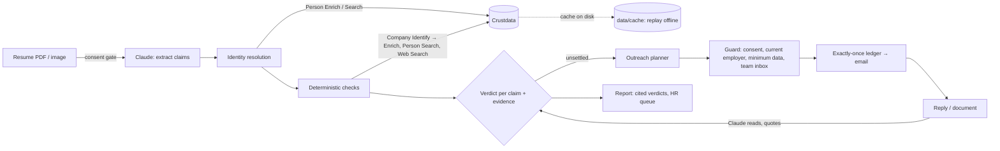

# Pramaan: background verification, done by an agent in minutes

> **Timing note for the judges:** we understood the start had moved to 10:15 PM and began building then, so the first commit (10:37 PM) predates 11:00 PM. Everything after it was built from 11:00 PM. *(Update this line with what the organisers told you.)*

**One line:** Pramaan takes a candidate's resume and returns a finished background-verification report. Every claim gets a verdict that cites its source, and a person sees only the cases the evidence can't settle.

**Theme:** Hiring, "Prove or disprove every claim on a candidate's record."

## The service

- **Who does it today:** background-verification firms (AuthBridge, First Advantage, HireRight) and in-house HR teams. Employers pay per check, for each hire.
- **How it works today:** an analyst emails each former employer's HR, waits, chases, and phones. A check takes **7–14 days**, so offers stall or go out before the check finishes.
- **Where it slips:** HR replies are slow and vague, small or defunct employers never answer, and "consistent with LinkedIn" passes for verified even though the candidate wrote both documents.

## What it does now (end to end)

1. **Consent gate.** No check starts until candidate consent is recorded.
2. **Reads the resume** with Claude (`claude-opus-5-5`): PDF, scan, image or two-column layout, turned into structured claims. Claude only reads; it never decides a verdict.
3. **Resolves the person** to one Crustdata record: by profile URL, or by name search scored on shared employers and dates. Common names that tie go to a human. A profile URL belonging to someone else is flagged.
4. **Checks every claim** with deterministic code (`pramaan/checks.py`) against evidence, labelled by **who controls it**:

| Check | Evidence | Controlled by | Catches |
|---|---|---|---|
| Employer exists and predates the job | Company Identify/Enrich, web search | company / third party | fake employers, jobs before the company existed |
| Dates and title | Person Enrich | candidate | stretched dates, inflated titles |
| Team size possible? | headcount and growth, roles by function | company | "led 25" at a 15-person team, or when every title on the profile is an individual-contributor role |
| Funding stage at joining | funding rounds with dates | investors / press | "joined pre-Series A" after the Series A |
| "Employee #N" | founding year, rounds, headcount | company | early-employee claims years after founding |
| Team existed | other people's profiles overlapping the same company, function and time | third parties | roles on teams nobody else was on |
| Overlapping jobs, education, references | resume itself, profile, reference's own history | internal / third party | moonlighting, wrong graduation year, references who never overlapped |

A claim is **Verified** only when evidence the candidate *can't edit* agrees. Agreement with the candidate's own profile is reported as **Matches profile**, never as Verified.

5. **Outreach:** one email per former employer, addressed to an HR contact found with Crustdata people search. A separate email asks the candidate to explain discrepancies *before* HR sees them.
6. **Closes the loop:** Claude reads untidy replies and uploaded offer letters, quotes the exact text, and updates the verdict.

**Where it still needs a person:** identity ties, possible fake employers with no trace anywhere, two jobs overlapping, and documents a candidate uploads to explain a discrepancy. A human signs those off.

## Safety and robustness

- **Every email passes a guard:**
  - consent is on file
  - it's never sent to the current employer
  - it contains no other employers' names and no phone numbers
  - under the event rules, **every message goes to our own team inbox** (`DEMO_INBOX`); with none set, nothing is emailed
- **Exactly-once:** every send is written to an on-disk ledger *before* it is attempted. A retry never resends, and a send interrupted by a crash is never resent blindly (`tests/test_exactly_once.py`).
- **Crash resume:** progress is saved after reading and after each role. A re-run reuses the resume already read, and cached Crustdata calls cost 0 credits.
- **Failing tools:** 429s back off using `x-ratelimit-reset`. A 402 or 403 becomes a readable message. A failed lookup makes that claim **Unverified**, saying why, rather than guessing. One broken check never stops the report.
- **Messy input:** legal names ("Pvt. Ltd."), renames, staffing-firm placements, `03/2019` and "till date" dates, `SDE-2` vs "Software Engineer II", "IIT Kanpur" vs "Indian Institute of Technology Kanpur", and a ±2-month date tolerance.

## How it's built



- **State:** `data/runs/*.json` (reports and checkpoints), `data/outbox/ledger.json` (sends), `data/cache` (every Crustdata response).
- **Runs on:** a single FastAPI process (`app.py`) with a live event stream to the browser.

## How we tested it

`redteam/generate.py` builds resume PDFs from real careers (people who agreed to be test subjects) and plants **one known lie** in each: title inflation, date stretch, fake employer, team size, funding stage or graduation year. It also writes **messy honest variants** (legal company names, odd date formats, abbreviated titles, two-column layout). `redteam/score.py` runs every PDF end to end and counts lies caught against honest claims flagged. The results appear on the Scoreboard tab.

| Run | Lies caught | Honest claims flagged |
|---|---|---|
| Synthetic offline data, checks only | 10/10 | 0 |
| Real careers, full pipeline | *fill in* | *fill in* |

## Approaches we considered

1. **One LLM agent with tools that decides everything.** Fast to build, but verdicts change with the wording, and citations are hard to trust. We rejected it for deciding, and kept Claude for reading.
2. **Resume vs. profile diff.** Easy, but it proves only that the candidate is consistent, since they wrote both. We kept it, labelled as candidate-controlled evidence.
3. **What we chose:** an LLM reads; deterministic checks decide against evidence the candidate can't edit; outreach handles the rest. Verdicts are repeatable, explainable and testable.

**What didn't work:** *(fill in from your night, e.g. a Crustdata field that was missing, matching problems)*

## The hardest case

*(Fill in. Likely candidates: a common name with two plausible records, or a real small employer with no data trace that looks like a fake.)*

## What we left out, and what's next

- **Real employer email addresses** via contact enrichment, and inbound email parsing (replies are pasted in tonight). Left out because the event rules forbid contacting outsiders.
- **Month-by-month headcount history:** older headcount is estimated from growth over up to 2 years and labelled as an estimate.
- **Education checks with institutions** (Indian Institutes of Technology and universities have verification desks), and **watchers** that flag a candidate editing their profile *during* a check.
- **Continuous re-verification** after hire, for regulated roles.

## Run it

```bash
python -m venv .venv && .venv/Scripts/pip install -r requirements.txt
cp .env.example .env    # ANTHROPIC_API_KEY, CRUSTDATA_API_KEY, PRAMAAN_MODE=live, DEMO_INBOX=<team inbox>
.venv/Scripts/python -m uvicorn app:app --port 8000      # http://localhost:8000
python -m redteam.generate --subjects redteam/subjects.json && python -m redteam.score
python -m tests.smoke_fixture && python -m tests.test_exactly_once
```

Modes: `live` calls Crustdata and caches every response; `replay` reads the cache only, for the stage if WiFi fails; `fixture` uses synthetic offline data (`fixtures/dataset.json`, all fictional).
